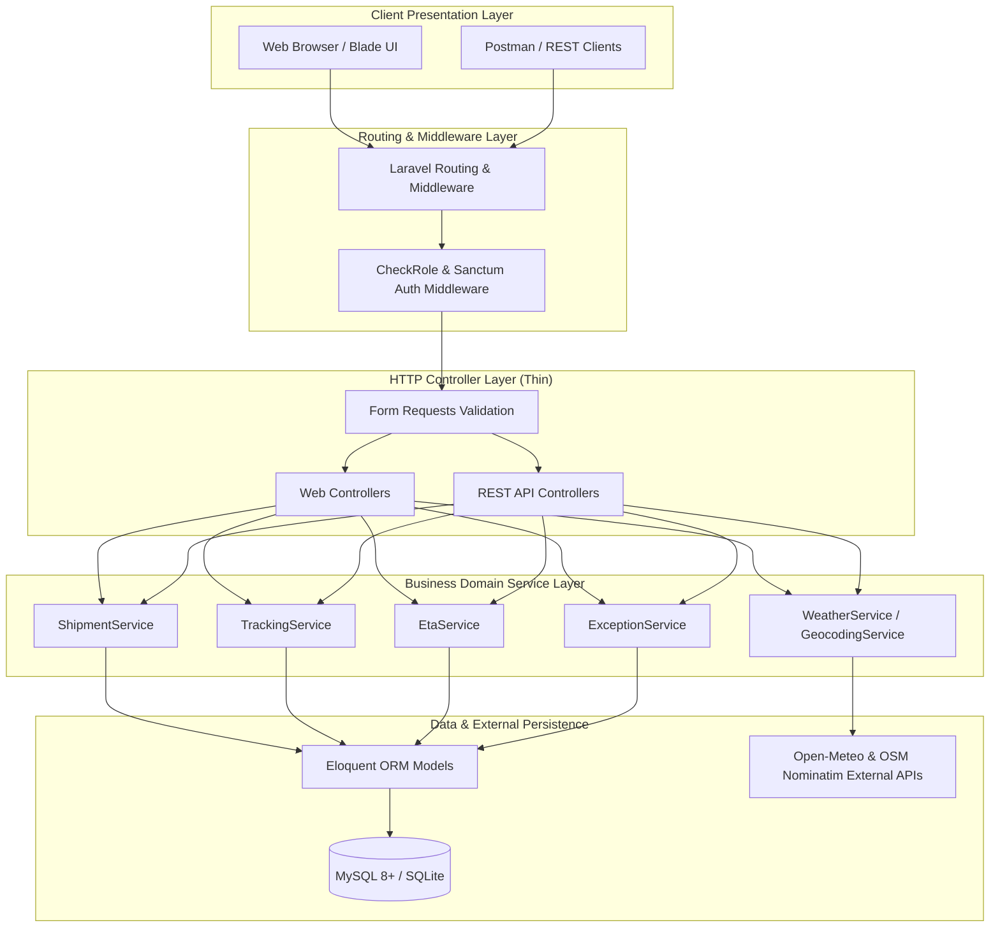
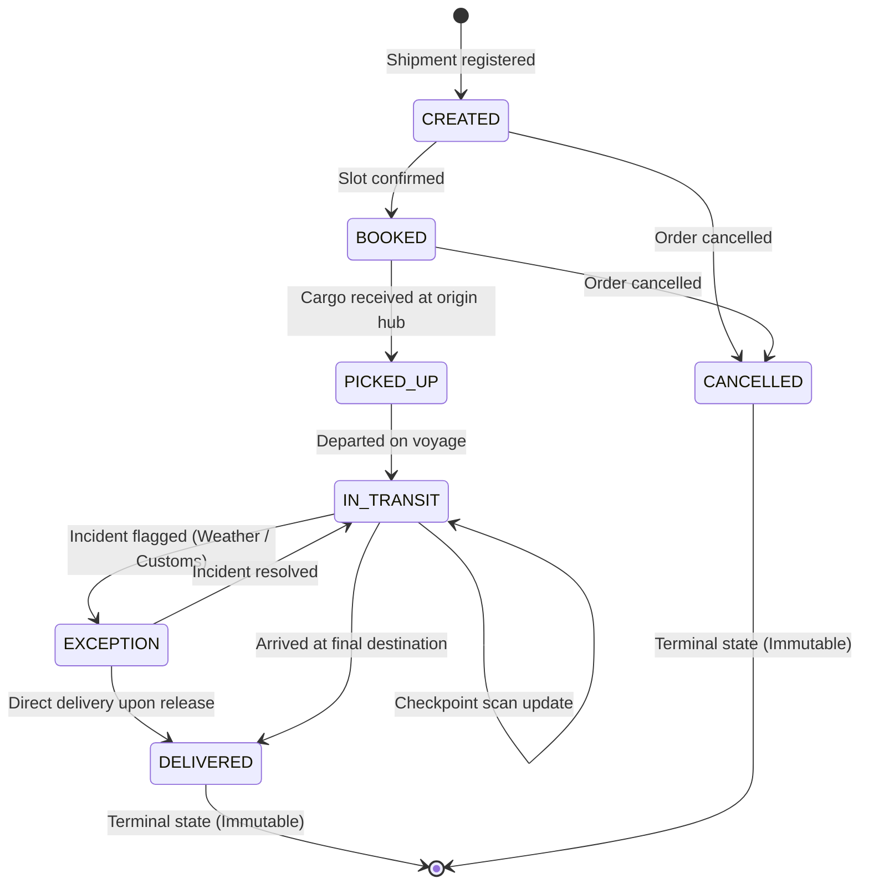

# CargoTrace — System Architecture & Design Guidelines

## 1. Architectural Overview

CargoTrace follows a strict **Layered Architecture** pattern adhering to clean architecture principles. HTTP request handling is decoupled from business domain logic to maintain high maintainability, testability, and auditability.

---

## 2. Layer Responsibilities & Architectural Rules

| Layer | Primary Responsibility | Components / Files |
|---|---|---|
| **Routing & Middleware** | URL dispatching, authentication token verification (`auth:sanctum`), and role authorization gates (`role:ADMIN`, `role:OPERATOR`, `role:CUSTOMER`). | `routes/web.php`, `routes/api.php`, `App\Http\Middleware\CheckRole` |
| **Form Requests** | Input sanitization, data validation rules, and preliminary request-level permissions. | `App\Http\Requests\StoreShipmentRequest` |
| **Controllers (Thin)** | HTTP concerns only: extracts validated input, invokes services, delegates database transactions to services, formats Blade views or JSON envelopes. | `App\Http\Controllers\*`, `App\Http\Controllers\Api\*` |
| **Service Layer** | Encapsulates all domain rules, state machine transitions, delay telemetry math, exception resolution, and transactional integrity. | `ShipmentService`, `TrackingService`, `EtaService`, `ExceptionService`, `WeatherService` |
| **Eloquent Models** | Data schema modeling, relationship cardinality (`hasMany`, `belongsTo`), type casting, accessors, and guarded mass assignment. | `Shipment`, `TrackingEvent`, `ShipmentException`, `Carrier`, `Location`, `User`, `AuditLog`, `Notification` |
| **External Integrations** | Resilient external telemetry requests with timeouts, error handling, caching, and graceful fallbacks. | `WeatherService` (Open-Meteo), `GeocodingService` (Nominatim) |

---

## 3. Core Business Rules & State Machines

### 3.1 Shipment Lifecycle State Transitions

Status transitions are strictly validated in `TrackingService::recordEvent()` and cannot be arbitrarily modified via direct input.

### 3.2 Deterministic ETA & Delay Rule (`EtaService`)

Delay detection is rule-based and deterministic:
1. **Target**: `$expectedArrival = $shipment->expected_arrival_at`
2. **Comparison Point**:
   - If `$shipment->status === 'DELIVERED'`: uses the delivery tracking event timestamp.
   - If active (`IN_TRANSIT`, `EXCEPTION`): uses `now()`.
3. **Calculation**:
   $$\text{delayHours} = \text{ceil}(\text{ComparisonPoint} - \text{ExpectedArrival})$$
4. **Severity Matrix**:
   - $\le 6 \text{ hours}$: `LOW` severity
   - $> 6 \text{ and } \le 24 \text{ hours}$: `MEDIUM` severity
   - $> 24 \text{ hours}$: `HIGH` severity (triggers Priority Operational Queue)

---

## 4. Security & Access Control Policy (RBAC)

1. **Server-Side Enforcement**: All routes are guarded by `CheckRole` middleware on the server. Hiding frontend buttons is never relied upon as a security mechanism.
2. **Customer Scoping**: Customers can only view shipments where `customer_id === auth()->id()`. Querying another customer's shipment by ID returns a `403 Forbidden` or `404 Not Found`.
3. **Audit Trail**: High-consequence mutations (`Shipment Created`, `Status Transition`, `Exception Reported`, `Exception Resolved`, `Shipment Deleted`) automatically trigger `AuditLog::record()`.
4. **Secret Management**: API keys and database credentials reside exclusively in `.env` and are strictly excluded from Git commits via `.gitignore`.
