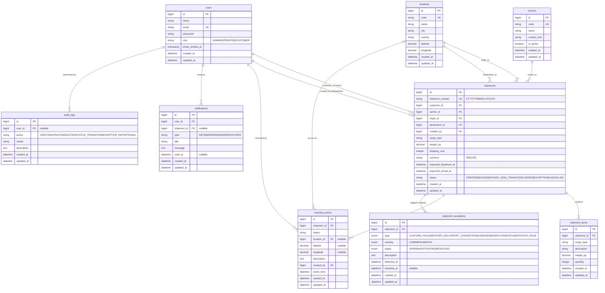

# CargoTrace — Entity Relationship Diagram & Data Dictionary

## 1. Entity Relationship Diagram (ERD)

---

## 2. Data Dictionary

### 2.1 Table: `users`
Stores user identities, login credentials, and role-based access levels.

| Column | Type | Nullable | Default | Description |
|---|---|---|---|---|
| `id` | BIGINT UNSIGNED | No | Auto Increment | Primary key. |
| `name` | VARCHAR(255) | No | - | Full name of the user. |
| `email` | VARCHAR(255) | No | - | Unique login email. |
| `email_verified_at` | TIMESTAMP | Yes | NULL | Verification timestamp. |
| `password` | VARCHAR(255) | No | - | Bcrypt hashed password. |
| `role` | VARCHAR(255) | No | `'CUSTOMER'` | User role: `'ADMIN'`, `'OPERATOR'`, `'CUSTOMER'`. |
| `remember_token` | VARCHAR(100) | Yes | NULL | Remember me token. |
| `created_at` | TIMESTAMP | Yes | NULL | Record creation timestamp. |
| `updated_at` | TIMESTAMP | Yes | NULL | Record update timestamp. |

### 2.2 Table: `carriers`
Stores logistics transport companies and freight carriers.

| Column | Type | Nullable | Default | Description |
|---|---|---|---|---|
| `id` | BIGINT UNSIGNED | No | Auto Increment | Primary key. |
| `code` | VARCHAR(20) | No | - | Unique identifier code (e.g. `MSK`, `MSC`). |
| `name` | VARCHAR(255) | No | - | Legal carrier name. |
| `contact_info` | VARCHAR(255) | Yes | NULL | Hotline, email, or operational phone. |
| `is_active` | BOOLEAN | No | `true` | Operational availability status. |
| `created_at` | TIMESTAMP | Yes | NULL | Record creation timestamp. |
| `updated_at` | TIMESTAMP | Yes | NULL | Record update timestamp. |

### 2.3 Table: `locations`
Stores ports, logistics hubs, airports, and geographic coordinates.

| Column | Type | Nullable | Default | Description |
|---|---|---|---|---|
| `id` | BIGINT UNSIGNED | No | Auto Increment | Primary key. |
| `code` | VARCHAR(10) | No | - | Port or terminal code (e.g. `SIN`, `JKT`, `RTM`). |
| `name` | VARCHAR(255) | No | - | Location facility name. |
| `city` | VARCHAR(255) | No | - | City name. |
| `country` | VARCHAR(255) | No | - | Country name. |
| `latitude` | DECIMAL(10, 8) | Yes | NULL | Latitude coordinate for GIS / Leaflet mapping. |
| `longitude` | DECIMAL(11, 8) | Yes | NULL | Longitude coordinate for GIS / Leaflet mapping. |
| `created_at` | TIMESTAMP | Yes | NULL | Record creation timestamp. |
| `updated_at` | TIMESTAMP | Yes | NULL | Record update timestamp. |

### 2.4 Table: `shipments`
Master cargo shipment records and status lifecycle state.

| Column | Type | Nullable | Default | Description |
|---|---|---|---|---|
| `id` | BIGINT UNSIGNED | No | Auto Increment | Primary key. |
| `shipment_number`| VARCHAR(255) | No | - | Unique tracking resi (`CT-YYYYMMDD-XXXXXX`). |
| `customer_id` | BIGINT UNSIGNED | No | - | Foreign key to `users.id` (Shipper/Customer). |
| `carrier_id` | BIGINT UNSIGNED | No | - | Foreign key to `carriers.id`. |
| `origin_id` | BIGINT UNSIGNED | No | - | Foreign key to `locations.id` (Origin hub). |
| `destination_id`| BIGINT UNSIGNED | No | - | Foreign key to `locations.id` (Destination hub). |
| `created_by` | BIGINT UNSIGNED | No | - | Foreign key to `users.id` (Operator who created). |
| `cargo_type` | VARCHAR(100) | Yes | NULL | Cargo category (Electronics, Machinery, etc.). |
| `weight_kg` | DECIMAL(10, 2) | Yes | NULL | Gross cargo weight in kilograms. |
| `shipping_cost` | INTEGER | No | `0` | Freight cost charge. |
| `currency` | VARCHAR(3) | No | `'IDR'` | Currency ISO 4217 code (`IDR`, `USD`). |
| `expected_departure_at` | DATETIME | Yes | NULL | Planned departure date and time. |
| `expected_arrival_at` | DATETIME | Yes | NULL | SLA target arrival date and time. |
| `status` | VARCHAR(50) | No | `'CREATED'` | Lifecycle stage (`CREATED`, `BOOKED`, `PICKED_UP`, `IN_TRANSIT`, `DELIVERED`, `EXCEPTION`, `CANCELLED`). |
| `created_at` | TIMESTAMP | Yes | NULL | Record creation timestamp. |
| `updated_at` | TIMESTAMP | Yes | NULL | Record update timestamp. |

### 2.5 Table: `shipment_items`
Detailed cargo manifest breakdown.

| Column | Type | Nullable | Default | Description |
|---|---|---|---|---|
| `id` | BIGINT UNSIGNED | No | Auto Increment | Primary key. |
| `shipment_id` | BIGINT UNSIGNED | No | - | Foreign key to `shipments.id` (CASCADE on delete). |
| `cargo_type` | VARCHAR(255) | Yes | NULL | Item classification. |
| `description` | VARCHAR(255) | Yes | NULL | Item description or package contents. |
| `weight_kg` | DECIMAL(10, 2) | Yes | NULL | Item weight in kg. |
| `quantity` | INTEGER | No | `1` | Number of packages/units. |
| `created_at` | TIMESTAMP | Yes | NULL | Record creation timestamp. |
| `updated_at` | TIMESTAMP | Yes | NULL | Record update timestamp. |

### 2.6 Table: `tracking_events`
Immutable historical checkpoint milestones for the cargo journey.

| Column | Type | Nullable | Default | Description |
|---|---|---|---|---|
| `id` | BIGINT UNSIGNED | No | Auto Increment | Primary key. |
| `shipment_id` | BIGINT UNSIGNED | No | - | Foreign key to `shipments.id` (CASCADE on delete). |
| `status` | VARCHAR(50) | No | - | Shipment status milestone achieved. |
| `location_id` | BIGINT UNSIGNED | Yes | NULL | Foreign key to `locations.id` (SET NULL on delete). |
| `latitude` | DECIMAL(10, 8) | Yes | NULL | Exact GPS checkpoint latitude. |
| `longitude` | DECIMAL(11, 8) | Yes | NULL | Exact GPS checkpoint longitude. |
| `description` | TEXT | Yes | NULL | Operational narrative of event. |
| `created_by` | BIGINT UNSIGNED | No | - | Foreign key to `users.id` (Operator/Staff). |
| `event_time` | TIMESTAMP | No | - | Historical event timestamp. |
| `created_at` | TIMESTAMP | Yes | NULL | Record creation timestamp. |
| `updated_at` | TIMESTAMP | Yes | NULL | Record update timestamp. |

### 2.7 Table: `shipment_exceptions`
Disruptions, holds, and operational anomalies.

| Column | Type | Nullable | Default | Description |
|---|---|---|---|---|
| `id` | BIGINT UNSIGNED | No | Auto Increment | Primary key. |
| `shipment_id` | BIGINT UNSIGNED | No | - | Foreign key to `shipments.id` (CASCADE on delete). |
| `type` | ENUM | No | - | `CUSTOMS_HOLD`, `WEATHER_DELAY`, `PORT_CONGESTION`, `DAMAGED`, `MISROUTED`, `DOCUMENTATION_ISSUE`. |
| `severity` | ENUM | No | `'MEDIUM'` | `LOW`, `MEDIUM`, `HIGH`. |
| `status` | ENUM | No | `'OPEN'` | `OPEN`, `INVESTIGATING`, `RESOLVED`. |
| `description` | TEXT | Yes | NULL | Investigation notes and incident description. |
| `detected_at` | TIMESTAMP | No | - | Timestamp when issue was flagged. |
| `resolved_at` | TIMESTAMP | Yes | NULL | Timestamp when issue was resolved. |
| `created_at` | TIMESTAMP | Yes | NULL | Record creation timestamp. |
| `updated_at` | TIMESTAMP | Yes | NULL | Record update timestamp. |

### 2.8 Table: `notifications`
In-app alerts and notifications dispatched to users.

| Column | Type | Nullable | Default | Description |
|---|---|---|---|---|
| `id` | BIGINT UNSIGNED | No | Auto Increment | Primary key. |
| `user_id` | BIGINT UNSIGNED | No | - | Foreign key to `users.id` (CASCADE on delete). |
| `shipment_id` | BIGINT UNSIGNED | Yes | NULL | Foreign key to `shipments.id` (SET NULL on delete). |
| `type` | VARCHAR(50) | No | `'INFO'` | `INFO`, `WARNING`, `DANGER`, `SUCCESS`. |
| `title` | VARCHAR(255) | No | - | Notification headline. |
| `message` | TEXT | No | - | Notification body text. |
| `read_at` | TIMESTAMP | Yes | NULL | Read timestamp. |
| `created_at` | TIMESTAMP | Yes | NULL | Record creation timestamp. |
| `updated_at` | TIMESTAMP | Yes | NULL | Record update timestamp. |

### 2.9 Table: `audit_logs`
System activity audit trail for accountability.

| Column | Type | Nullable | Default | Description |
|---|---|---|---|---|
| `id` | BIGINT UNSIGNED | No | Auto Increment | Primary key. |
| `user_id` | BIGINT UNSIGNED | Yes | NULL | Foreign key to `users.id` (SET NULL on delete). |
| `action` | VARCHAR(255) | No | - | Action tag (`CREATED`, `UPDATED`, `DELETED`, `STATUS_TRANSITION`, etc.). |
| `model` | VARCHAR(255) | No | - | Target model name (`Shipment`, `Carrier`, `Location`, etc.). |
| `description` | TEXT | No | - | Detailed human-readable log entry. |
| `created_at` | TIMESTAMP | Yes | NULL | Record creation timestamp. |
| `updated_at` | TIMESTAMP | Yes | NULL | Record update timestamp. |
